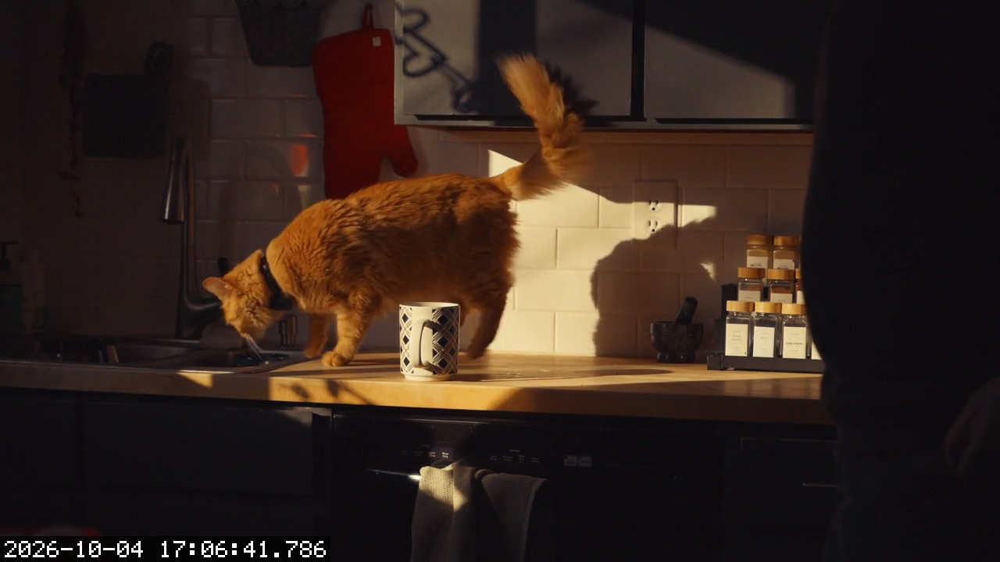

# Example: catch a cat on the kitchen counter

This example runs far-sight without a real cat, or even a real camera. It plays a short stock clip into a virtual webcam (`v4l2loopback`), and far-sight watches that device exactly as it would watch a real one. The clip starts on an empty counter, then the cat jumps up, walks along it and leaves.



*Demo footage: ["Ginger Cat Walks on Sunny Kitchen Counter"](https://www.pexels.com/video/ginger-cat-walks-on-sunny-kitchen-counter-35674403/) by [Alex Moliski](https://www.pexels.com/@alexmoliski/) from Pexels, used under the [Pexels License](https://www.pexels.com/license/). The clip isn't stored in this repository; the script downloads it from Pexels the first time you run it.*

## Requirements

- far-sight built in `build/` (see the [top-level README](../../README.md#build))
- `ffmpeg`, and `curl` for the downloads
- the `v4l2loopback` kernel module. On Ubuntu it ships as `v4l2loopback-dkms`, so if `modinfo v4l2loopback` finds nothing, install that package.

## Run it

1. Create the virtual webcam. This needs sudo once per boot:

   ```sh
   sudo modprobe v4l2loopback video_nr=10 card_label="far-sight demo" exclusive_caps=1
   ```

2. Run the demo from the repository root:

   ```sh
   ./examples/cat-on-counter/run-demo.sh
   ```

   On the first run, the script:
   - downloads the SmolVLM-500M model into `models/`, if it isn't there yet;
   - downloads the clip into `examples/cat-on-counter/media/`;
   - builds `demo.mp4` with the empty counter first;
   - starts looping the video into `/dev/video10`;
   - runs far-sight against it.

   Press Ctrl-C to stop.

3. Look at the results:

   ```sh
   ls examples/cat-on-counter/captures/
   cat examples/cat-on-counter/captures/events.csv
   ```

## What you should see

```text
[2026-10-04 17:06:37.645] camera /dev/video10 opened at 1280x720 YUYV
[2026-10-04 17:06:37.785] watching for "a cat on the kitchen counter" every 1000ms (saving to captures)
[2026-10-04 17:06:40.785] p_yes=0.987 MATCH streak=1 (786 ms)
[2026-10-04 17:06:41.786] p_yes=0.998 MATCH streak=2 (722 ms)
2026-10-04 17:06:41.786 captures/2026-10-04_17-06-41.786.jpg 0.998
[2026-10-04 17:06:42.787] p_yes=0.997 MATCH streak=1 (719 ms)
```

- **Empty counter:** it scores about 0.002, and once the scene stops changing the model isn't run at all.
- **Cat on the counter:** two matches in a row fire an event. The JPEG is named after its capture time, has that time stamped in the corner, and gets a row in `events.csv`.
- **Cat stays:** the 15 s cooldown keeps it to one photo per visit, so each loop of the clip produces one event.

Pass extra far-sight options after the script name. For example, add `-v` to log every check, including skipped static frames, or add a desktop notification:

```sh
./examples/cat-on-counter/run-demo.sh -v \
    --on-match 'notify-send "far-sight" "Cat on the counter at $FARSIGHT_TIME"'
```

## Settings

You can override these with environment variables:

| Variable | Default |
|---|---|
| `DEVICE` | `/dev/video10` |
| `FARSIGHT_BIN` | `build/far-sight` |
| `MODEL`, `MMPROJ` | SmolVLM-500M files in `models/` |
| `CLIP` | unset, so the Pexels clip is downloaded and prepared; set it to a video file to play that as-is |
| `OUTPUT` | `examples/cat-on-counter/captures` |

When you're done, remove the virtual webcam with `sudo modprobe -r v4l2loopback`.
